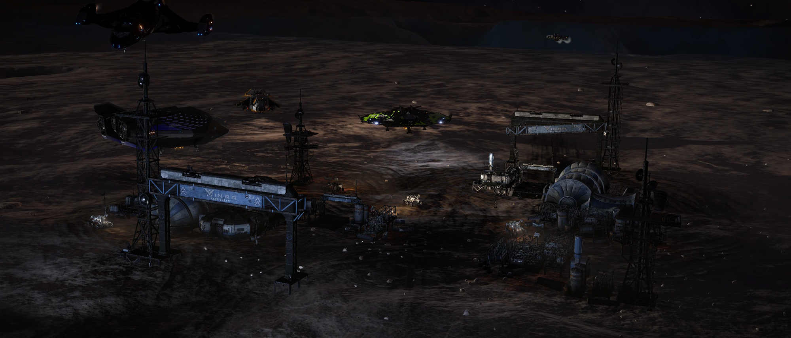

> The present is determined by our past actions, and the future by the present.  
> **\- Swami Vivekananda**

Humanity never learns. Time and again we have caused total destruction just for the sake of it. And time and again we have paid the price for such a decision. The presence of Thargoids is no more a news but we are still not sure of their intentions. The Aegis Initiative is preparing for war and the humanity is at odds whether to support it or not.

Amidst all of this, commanders discovered something that sheds a light on our past actions. They found abandoned bases operated by Intergalactic Naval Reserve Arm, also called INRA. And the logs found in those bases are quite incriminating.

The discovery of these bases struck me. I realised that the truth of INRA must be shown to as many as possible. So I, under the banner of Knights of Karma, planned an expedition to all the discovered bases. The only issue was the presence of people who would like to see that the expedition was not successful. So I reached out to our allies, The Armada of Light to provide protection for the explorers. Together we planned to start our expedition on the 25th of November, 3303.

The expedition started at 1700 hrs Galaxy Time from Ray Gateway in Diaguandri. We were a bit less than 30 commanders in various ships. We had 10 systems to look through. We went from one way point to another without any incidents. The space seemed clear and the protection fleet had no hostiles in contact.

*Sifting through an INRA base - __Image by CMDR Lyxavier__*

Then they appeared.

Hostiles were spotted in way point 6 in the system of LP 389-95. Most of the explorers were already in system when they were spotted. CMDR Akuma Tebori from TAOL raised the warning and I commanded all explorers to leave the system at once. TAOL and hostiles engaged in combat. We got reports of more than 20 ships fighting at once while we waited out in neighbourhood systems. After a brief encounter we got the report that hostiles had disengaged and left the system. Unfortunately we lost 2 explorers. One was a victim from the hostiles before he was able to leave way point 6. The other was brought down in an unrelated case of murder. Still, we had to move on.

What we learned from the bases can be summarised easily. INRA had developed a bio-chemical weapon against the Thargoids and outright committed genocide on them. Then they murdered many more humans to keep this act a secret.

The expedition was completed in a little more than 5 hours. Overall, it was a very successful expedition as many had successfully reached the final way point of our home system Qa'wakana. The only thing that I hoped for while turning in my exploration data is for the galaxy to know the truth of what happened in the past and judge the actions of those who committed them so that this time around we can take a better choice, for our future.
