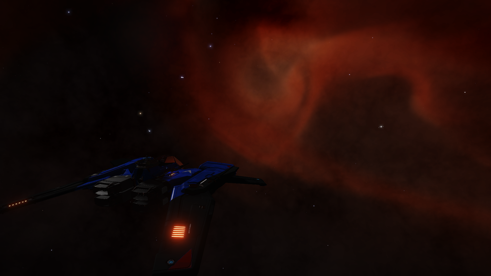

At last I have reached my first waypoint of my journey towards Solitude. TRAIKAAE AA-A H2 Nebula. Not really interesting but a change for sore eyes nonetheless.

When I started out from Qa'wakana, I decided to take another scenic route, the previous one being a route I took while returning back to Qa'wakana last time. At that time, I took a route with strange worlds and systems, which you can find [here](https://www.edsm.net/en/galactic-routes/show/id/1230/name/The+Return+of+the+Knights/shareKey/b4768bf77a3ac28dde980ca86eeffff41588bbf0). This time, in an attempt to do something different, I have decided to set my waypoints at the various nebulae on the way. And this brings me to my first nebula enroute.

*TRAIKAAE AA-A H2 Nebula*

I made this journey of a little more than 4800 LY in 15 days. Nothing to brag about, I know, but I took my time going from system to system. It was a relaxing experience to jump from to a system and look around, scan a few stuff, land at a geological site before moving to the next system instead of buckyballing all the way. At this rate, I _might_ reach my destination in a couple of months or so.

My next waypoint is the Lagoon Nebula which is vertically below me in the galactic plane. This would mean, that I would be making no progress towards destination but it would another nebula in my book.

Which brings me to an idea I had. Nebulae are somewhat special to me. They always fascinate me and I always gravitate towards them. So, I am planning to go through my flight logs and make a note of the Nebulae that I have visited till now. I have made a [post](/nebula-visit-log/) with the list so that I keep adding to them as I visit new nebulae.

Now I am off to the gaseous vistas of colour. Fly safe. o7
