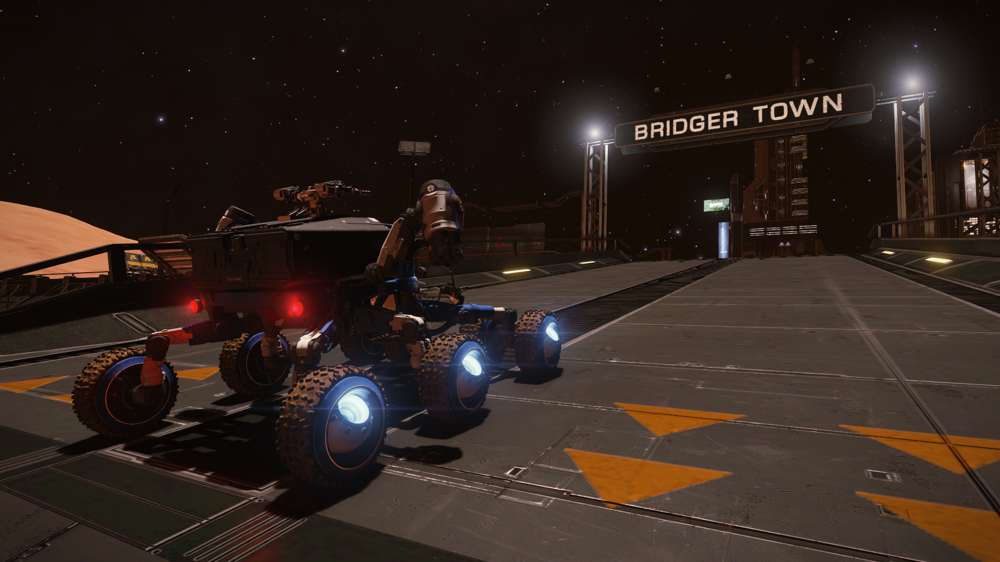

All journeys come to an end. Even the greatest ones. A journey of mine came to an end today. But as they say, it's not the end but the journey itself that matters. And this journey was a very important one for me.

The past few months had been pretty hard on my life. I had lost people very important to me. Our squadron was shrinking due to CMDRs hanging their boots and no fresh blood. I was beginning to question my life as a CMDR myself. I decided to head out to the black, to the edge of the galaxy to have some time to think. Then I came to know of the The First Great Planetary Expedition. And it struck a chord with me.

I returned back to the bubble and contacted CMDR Alec Turner, who was heading the expedition. My only concern was the nature of the expedition. Now I am no buckyballer and certainly won't be able to finish a circumnavigation within days. Thankfully, everyone was very welcoming and my concerns were invalidated soon. We started out on the 27th March.

Today is the 50th day since. I have lost 4 of my 5 SRVs that I brought into the journey but other than that the journey was incident free. This gave me lots of time to think.

I have now become invigorated with purpose now. I have to bring activity back to our squadron, join the Interstellar Initiative, all the while keeping an eye on the BGS.

*Reached the end*

A journey has ended and another is about to start.
