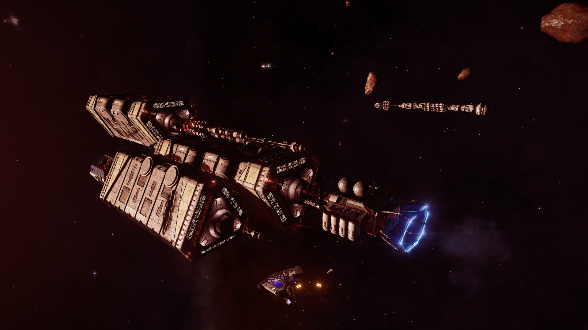
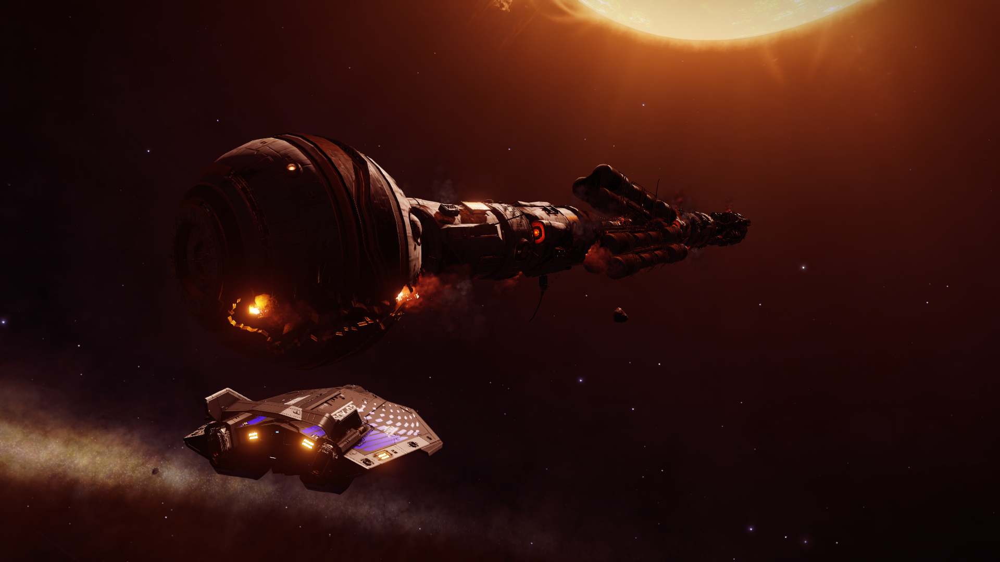
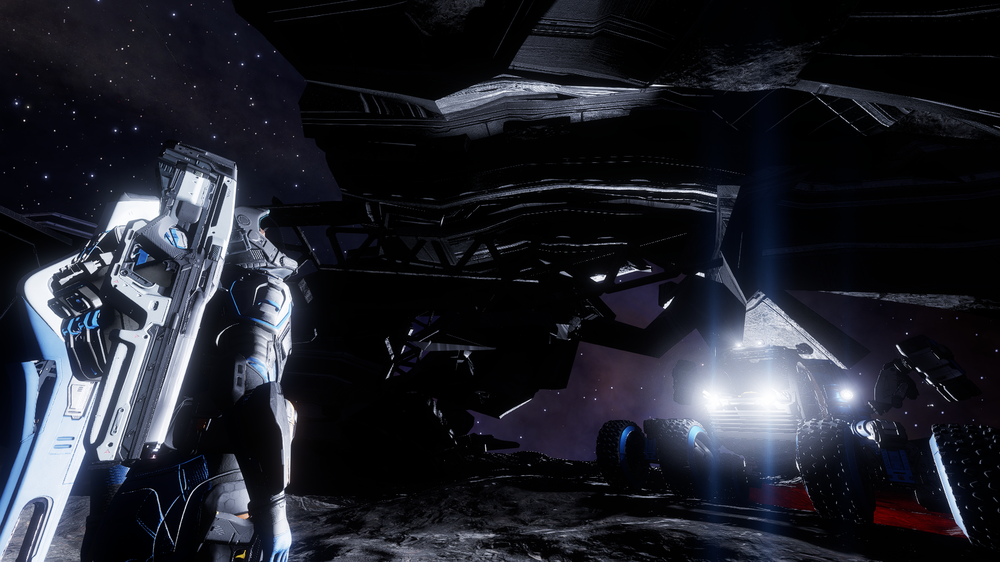
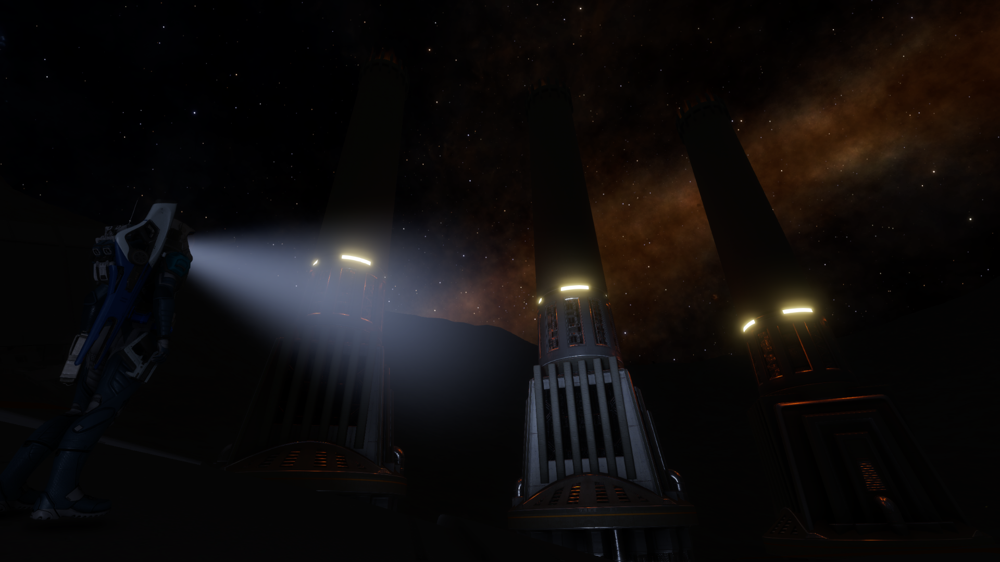
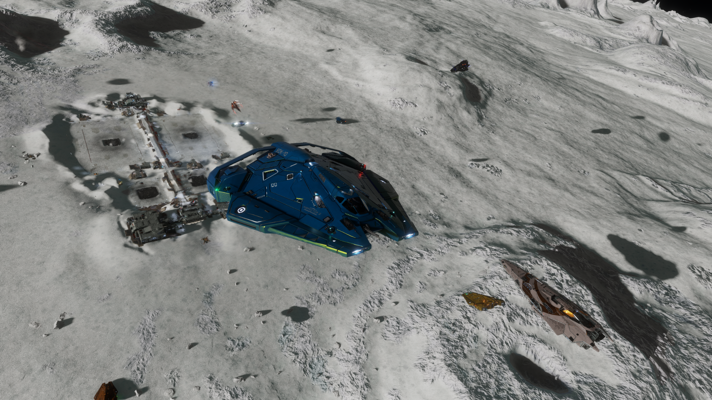
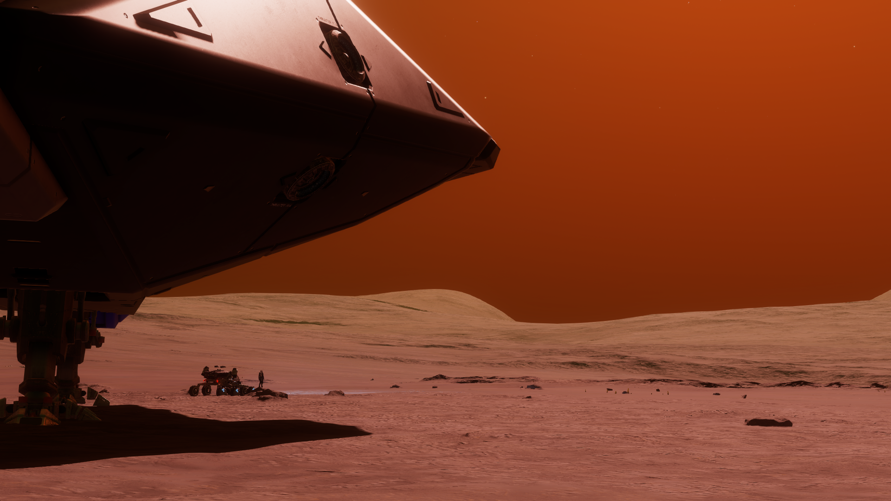
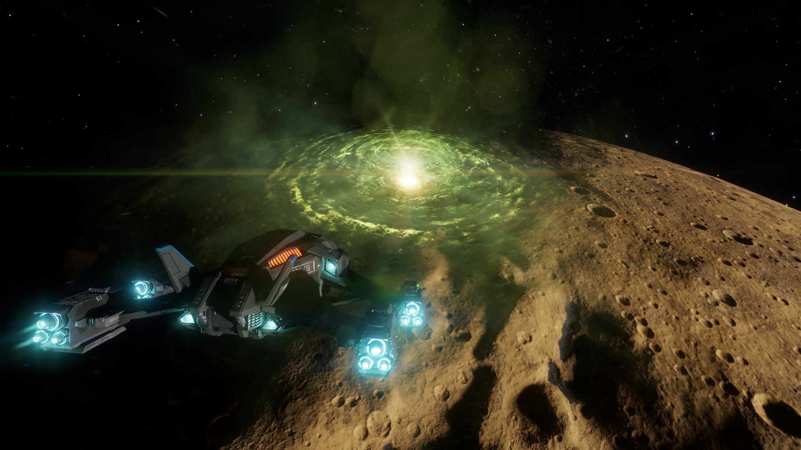

This has been one hell of a week. Or should I say that this week has been hell. I am not sure how to feel about the things that have gone through these past few days. Everything that could go wrong, went wrong. My worst fears had come true.

## The Past

I was unsure how to begin but I decided on starting from the point I encountered the events as that's likely to reflect the reality of the reader. It all began with the arrival of a derelict megaship in the Chukchan system. Derelict and abandoned megaships were unheard off and the arrival of Adamastor, as this megaship was called, created a lot of noise in the bubble. On proper inspection, it was discovered that it was travelling at sublight speeds for two centuries! The disappearance of the crew was a mystery but few realised at that time, how dark the reason would turn out be.

The Adamastor transmitted encrypted signals which led to the discovery of a sister megaship called the Hesperus. The decryption key was supplied by an anonymous source called "Salvation". CMDRs were able to access some data even as it was being taken apart by the Scriveners.

*The Scrivener clan's Dredger(near) and the Hesperus(far)*

Then, Salvation called again. This time, he used the minor faction Taurus Mining Ventures as a mouthpiece to announce a reward to anyone submitting the logs collected from the Hesperus. He claimed to be a scientist and the saviour of humanity. Many believed him, including me. His words were sweet given the daily incursions of Thargoids in human space. But in hindsight, this was another red flag.

The Thargoids continued attacking human space, including Delphi, where Aegis was based. Alexandria, the Aegis owned megaship jumped out to protect losses and was carrying a large quantity of Guardian artefacts. The Thargoids kept the chase. The last communications received from the Alexandria was when it was preparing to jump to HIP 30944. But they never reached there.

Aegis informed the media that they were presuming that the Alexandria was lost with all hands aboard. Soon after, Salvation emerged again claiming that tracking some listening posts would lead to the survivors from Hesperus. Considering that it was over 200 years old, surely no one could survive, right?

*The Hesperus*

Tracking these signals led to the discovery of a Guardian vs Thargoid battlefield. Quickly, both the Aegis and the Taurus Mining Ventures moved in to claim the site. Remember how Salvation spoke through the Taurus Mining Ventures? Remember the red flag that we should have seen?

Both Aegis and Taurus Mining Ventures asked for Guardian artefacts to be delivered in order to secure the bid to claim the site. By now, Aegis had become hugely unpopular, mostly because of how ineffective it was to control the Thargoid threat. This caused people round the bubble to rally up for Taurus Mining Ventures, a _seemingly_ independent minor faction and they won by a huge margin. The Aegis suffered a huge blow when it was suspended and an inquiry into the disappearance was established under the joint order of all three super powers.

At this point, the timer of the mysterious "Hyford's Cache" expired releasing a message pointing to the HIP 26176 system where details regarding Project Seraph was found. This was an inhuman experiment to attempt to integrate a human pilot with a Thargoid ship. Only one test subject managed to escape, "D-2" with the help of someone from Oaken Point. There were references to something or someone called "The Witch" and Azimuth.

*Hyford's crashed ship*

Salvation was able to predict an attack on Cornsar and was able to make the Thargoids withdraw, claiming that he had a weapon capabale of being a better deterrant than what Aegis ever could be.

Aegis Admiral, Aden Tanner called out the unauthorized activation of a weapon by Salvation as Taurus Mining Ventures' megaship, Bright Sentinal, moved to Merope on Salvation's request. Looking back it was odd that no one considered the fact that Taurus Mining Ventures doing what Salvation commanded was unnatural. But to many of us, Salvation gave what Aegis couldn't and many were willing to turn a blind eye to everything else. No one listened to Tanner and frustrated, he initiated a rogue battle with Taurus Mining Ventures helmed by the megaship, Musashi. Unfortunately, he lost and was arrested by Aegis soon after. This was in effect the final piece to Salvation's goal.

The super powers started to accept that Salvation was better than what any of them could do and slowly started giving their support. Aegis was shut down and all their assets and personnel were distributed among the super powers. Soon after, as if by coincidence, the megaship Alexandria was found after 7 months. Its condition pointed to the fact that it was attacked and no survivors or Guardian relics were found. It was found that the raiders who attacked the Alexandria worked for someone called "The Witch". This harked back to the logs found regarding Project Seraph. This "Witch", whoever they were, had managed to survive over 200 years and were determined to continue their xenological research. Other data suggested that "The Witch" worked for something called the Azimuth Biochemicals.

*Fort Asch in HIP 22460 7 C*

This information caused some within the powers to appeal for the Aegis to be reinstated but it was already too late. The Thargoids started attacking multiple systems en-masse. Surprisingly, they withdrew every time a claimed weapon by Salvation was fired. But Salvation's anonymity and true intentions were not hidden for long. INRA outposts in the system DG Canum Venaticorum were found thanks to an untraceable tip. And the information contained in their suggested that Salvation was none other than Dr Caleb Wycherley, former vice-president of research at Azimuth Biochemicals and his team was responsible for the development of the controversial mycoid bioweapon deployed by INRA during the First Thargoid War. And as should be obvious now, Dr Caleb Wycherley was nicknamed "The Witch"! It is presumed that the details of this information might have come from the escaped test subject "D-2". Salvation, once realising that his secret is out, quickly proceeded to rebranding Taurus Mining Ventures to Azimuth Biotech. Yes, that Taurus Mining Ventures that independent CMDRs from all over the bubble has been supporting since the first day. Remember the red flags we all missed?

This information enraged a lot of CMDRs including me. I felt cheated and dragged around like a fool. I decided to join a coalition of independent CMDRs called "Operation: Wych Hunt". This was organised by CMDR Psykit and we all wanted to try and hurt Azimuth Biotech as much as we could. Our goal was strip them off all their assets and kick them out of all systems they were in. We knew that we were going against a psychotic madman who had the backing of all three super powers, still we tried to drag them down as much as possible, maybe until an alternative appeared. Moreoever, we were apprehensive of the outcome of his plans. Because if he fails, no one had any idea what that would result in.

*Leaving a settlement after a hard fought victory against Azimuth Biotech*

But nothing like that happened and Salvation soon announced his ultimate weapon against the Thargoids. A weapon to relieve us from the Thargoid problem once and for all. He called it the "Proteus Wave". A fitting name for a man who calls himself "Salvation" and is nicknamed "The Witch". Despite all our efforts to delay the inevitable, Salvation fired the weapon on the 9th of August 3308.

## The Present

I reached the system HIP 22460, where the weapon would be fired from a day early. No matter what happened, I wanted a front row seat. I went and landed at a few nearby planets because who knows if I would be able to do that in the future. After that, I docked at the Bright Sentinal, Salvation's megaship to take a quick look at the general mood of the people there. Everyone looked pretty confident. Maybe Salvation's confidence rubbed off of them or maybe they actually believed the weapon would work. Anyway, with a few hours till the firing, I was considering if I should stay docked or leave the megaship. I decided to leave and that would lead to one of the best decisions I have taken as a CMDR. I parked my ship right above the permit exclusion zone of the planet 10B, almost vertically above the location of the Proteus Wave.

*One last look from HIP 22460 13 E before the Proteus Wave fired*

At 0800 hrs, the Proteus Wave fired. There was a moment when I felt like, "Did he actually succeed?". I was hearing about Thargoid ships stopping dead in their tracks through the comms, as if someone pulled their plugs. Their was a moment of joy even though I was fighting Salvation the past 2 months. Then, things went south. The Proteus Wave started generating anomalous signals and huge energy bursts. My HUD was glitched and I could hardly access my panels. My COVAS sounded like they had a sore throat. The comms were now filled with CMDRs reporting the the stopped Thargoids had come back to life and were more aggressive than ever. Dread started to fill me and I knew our worst fears were coming true. I proceeded to jump to supercruise when two interceptors jumped in and tried to disable my ship. Thankfully, I was carrying a Shutdown Field Neutraliser. They proceeded to shoot me. No scanning, nothing! I wasn't carrying anything that would generally make them mad. Straight up aggression. I continued to attempt to supercruise but they were inhibiting my ability to supercruise due to their high Mass Lock Factor. I was torn between switching to High Waking or keep boosting while watching my shields vanishing and my hull thinning. Fortunately, I was able to boost enough to get out of their Lock Factor influence and jumped to supercruise.

*The site of the Proteus Wave. Came back with a better ship for one last look*

Once in supercruise, I calmed my nerves. I knew what I was into. I noticed that my ship electronics were still glitching and my Guardian modules were rendered useless. The first thing I remembered was to check the status of Bright Sentinel. Salvation or not, they were still humans. I jumped into Bright Sentinel and I was met with a sight of absolute destruction. It was completely destroyed and even if there were any survivors, the Thargoids were methodically, checking them out. I knew my Asp Explorer, "Antrix" was useless. I didn't want to add another number to the tally of casualties and immediately jumped out before the Thargoids could get a hint of my presence.

I roamed around the system, checking each megaship and Capital ship present in the system and wherever I dropped in, I saw nothing but destruction. Realising the futility of my presence, I jumped out of the system and docked at my Carrier which was in another system a few LY away.

Once in relative safety, I was able to ponder a bit on what happened. The Proteus Wave didn't work. The site of the weapon has turned into visual spectacle of an anomaly and no one really knows what's happening down there. The Thargoids are madder than ever and HIP 22460 is lost to the Thargoids. Some brave CMDRs are still fighting the Thargoids with non-Guardian weapons but I don't know how long we can sustain this. Salvation's fate is unknown and the pessimist in me says that he will be back. Someone who has plotted this for over 200 years has to have a plan B or C or D or ...

Meanwhile, there is a discernible silence from the super powers. They went all in on Salvation and all the lives that were lost in HIP 22460 are as much on their hands as is Salvation's. I am eagerly waiting for what they have to say about this mess. Right now, the future is very uncertain. As uncertain as the ... _thing_ that I am carrying with me. It seems like this _thing_ has raised the curiosity of both Ram Tah and Prof. Palin and is giving me big bucks for _them_. Hopefully, they find some answers, cause there are a lot of questions. A lot of questions from a lot of angry people in the galaxy.
