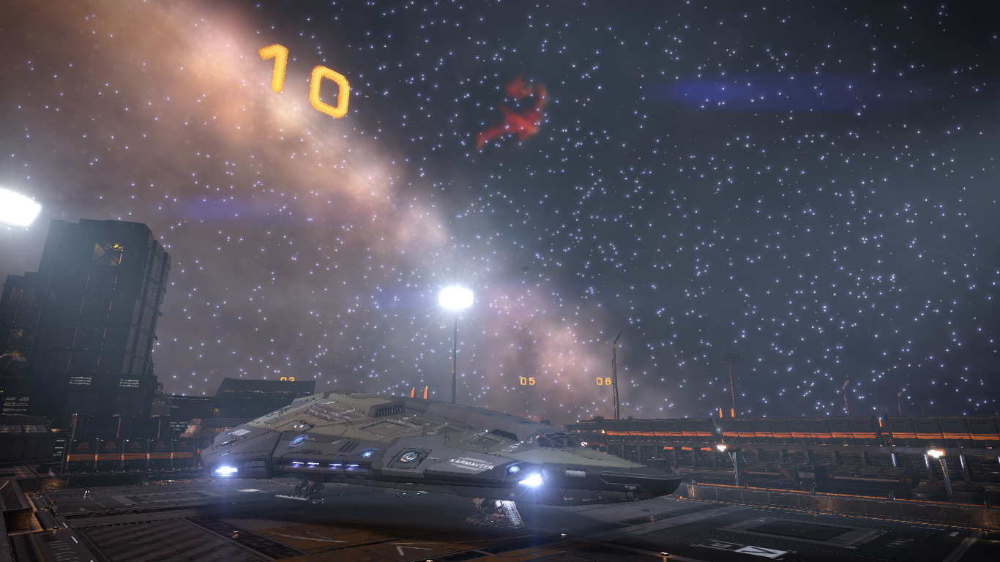

Power, is a strange thing. Power can be said to be the ability to do something. The ability to make a change. This ability in turn can create fear in the hearts of the living because the change might not be good for all. And this fear can in turn create control. But power does not necessarily has to be used for evil. One can combine power and responsibility and can create harmony instead of fear. This harmony brings faith on those who are powerful and thus can create control.

We believe in bringing harmony through our actions and for that we need to show our power.

Our power was shown to all when we staged a coup in Solitude and overthrew the controlling faction, Infinity's End Deep Space Company, and got back control of our home. Since we believe in harmony, we needed the coup to be completed as quickly as possible. We were able to complete the coup in a war that lasted only 3 days.

The war was fought with utmost precision. CMDR Jorer, CMDR Blood Drunk and CMDR Oddlock fought valiantly alongside me and we won the war without losses in between us. We are looking forward to times of serenity once more.

With the system back in hand, I am planning to spend some days idling around. I find mining to be particularly soothing and I just offloaded a couple of hundred tons of ore at Knight's Retreat.

*Preparing to offload mined ores*

Let's see what the future presents. Until then, fly safe o7.
